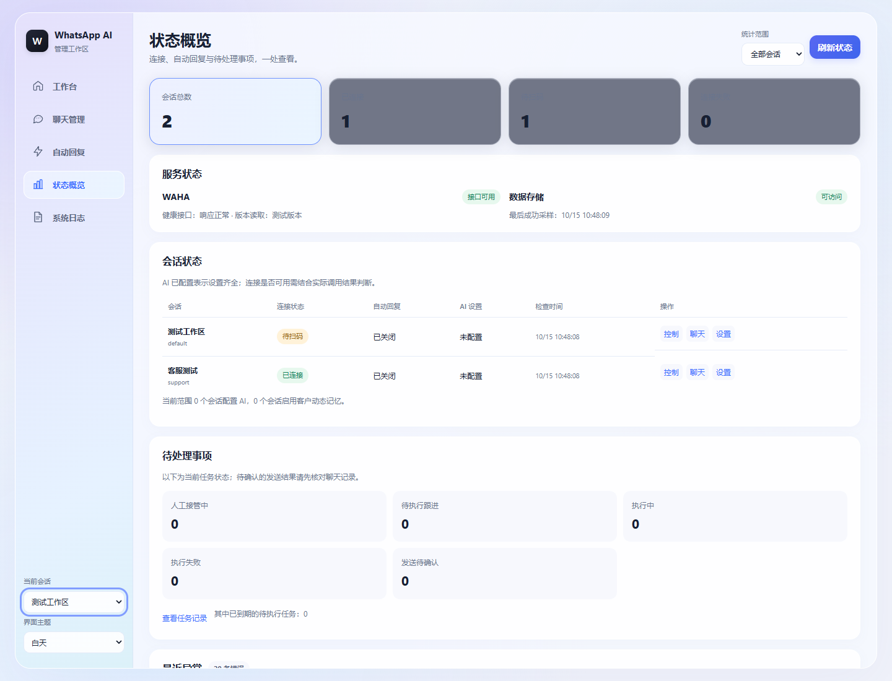
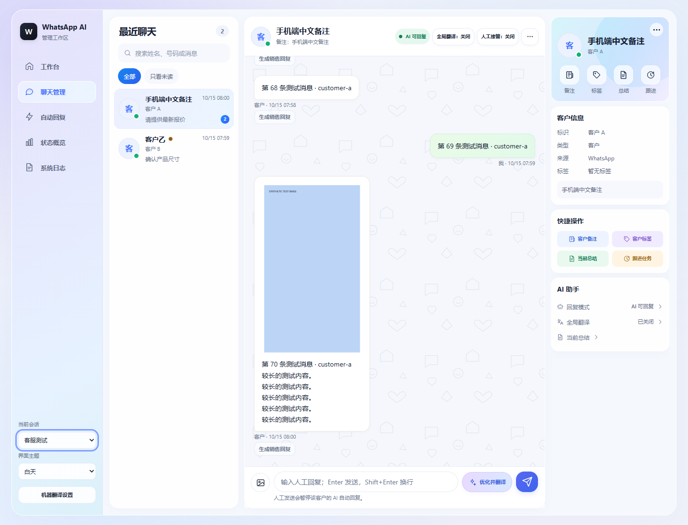
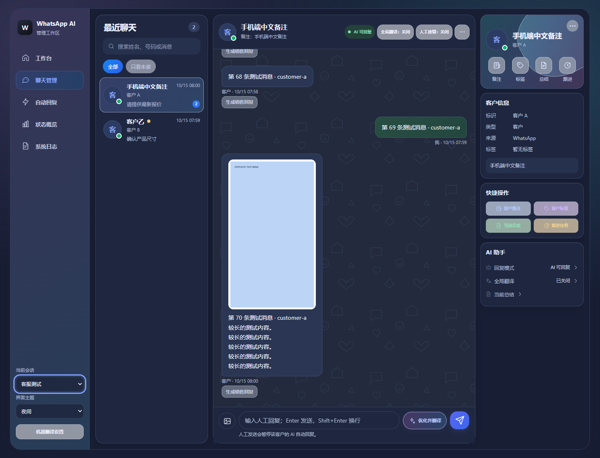
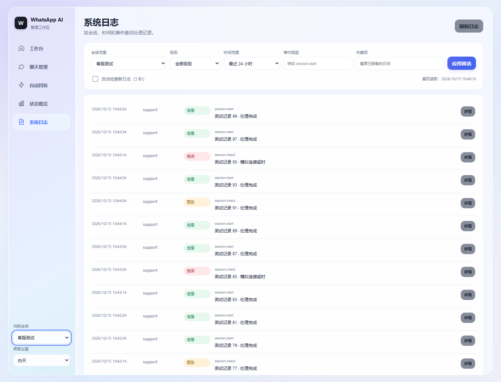

# WhatsAPP AI管理面板

基于 WAHA + Docker 的 WhatsApp 多会话 AI 管理面板，支持 AI 自动回复、聊天管理、人工接管以及图片和文字发送。通过一键安装脚本即可完成环境准备、配置生成和服务启动。

## 界面预览

1.0.26 新增加密 GLM 能力配置、客户图片自动回复、视觉推理、图像生成预览和确认发送，同时保留产品图片库和全局翻译总开关。以下界面截图均使用演示数据。









## 一键搭建

### Linux/macOS

在终端执行以下命令，脚本会从 GitHub `main` 分支下载并启动面板：

```bash
curl -fsSL https://raw.githubusercontent.com/CangNan99/waha-panel/main/bootstrap.sh | bash
```

### Windows

请先安装 Docker Desktop 和 PowerShell 7，然后执行：

```powershell
git clone --branch main --depth 1 https://github.com/CangNan99/waha-panel.git waha-panel
Set-Location -LiteralPath .\waha-panel
pwsh -File .\install.ps1
```

首次安装会自动生成 WAHA API 密钥、webhook 密钥、面板数据加密密钥和管理员初始密码。安装成功后会同时显示面板账号、WAHA Dashboard 账号，以及面板密码、WAHA 密码和 API Key 的掩码值；真实凭据只保存在受限的 `.env`、`secrets/waha_credentials` 和 `secrets/panel_admin_bootstrap` 文件中，不会写入安装输出、网页或日志。不要把这些文件上传到公共仓库。

这是空白业务安装，不会带入现有 WhatsApp 会话、二维码、聊天、客户资料、AI 密钥、WooCommerce、PayPal、产品或订单数据。

## 安装完成后

1. 打开面板：<http://127.0.0.1:3003/>
2. 使用安装脚本首次输出的管理员账号和密码登录。
3. 创建 WhatsApp 会话并扫码连接。
4. 进入聊天管理，配置 AI 自动回复或进行人工接管。

首次认证成功后，同一浏览器配置文件会保持 7 天登录状态；关闭并重新打开浏览器不会立即要求重新登录。清除该站点 Cookie、换浏览器或换设备后需要重新认证。

面板和 WAHA 通过 Docker 内部网络连接。默认只绑定本机端口：面板为 `127.0.0.1:3003`，WAHA 为 `127.0.0.1:3002`。数据保存在命名 Docker 卷中，分别为会话、媒体和 SQLite 面板数据，没有额外数据库服务。

## 主要能力

- 多 WhatsApp 会话统一管理
- AI 自动回复、摘要和标签
- 管理员产品图片库：按产品标签绑定图片，AI 严格匹配唯一主图后可直接发送
- 客户图片多模态识别（使用支持视觉的 OpenAI 兼容模型）
- IPTV 试用成功后自动添加只读系统标签“IPTV测试过”，并在 12 小时后按客户语言询问测试体验
- 按客户独立保存的加密动态记忆（在自动回复设置中开启）
- 聊天列表、消息收发和人工接管
- 当前聊天可在阿里云机器翻译专业版与 AI 模型翻译之间手动切换，并以双行显示原文和中文译文
- 打开聊天时定位最新消息，新消息到达时自动跟随
- 图片、文字等消息发送
- Docker 卷持久化、备份和独立更新
- 本地端口部署，可配合 Nginx 反向代理和 HTTPS 使用

### 产品图片库与自动发送

进入左侧“产品图片”页面上传 JPG、PNG 或 WebP 图片，设置产品标签、说明模板、优先级和主图状态。全局自动发送开关默认开启，每日上限默认 20 张；关闭开关后所有聊天都会停止自动发图。AI 只有在客户当前消息明确提到对应产品标签时才会调用发图工具，标签缺失、停用图片或同一优先级存在多个主图时会回退为文字回复。每条客户消息最多发送一张图片，WAHA 返回未知状态时会记录 `UNKNOWN` 且不自动重试。

图片元数据和文件都在 `panel_data` 卷内，备份和恢复必须同时包含 SQLite 与 `product-images/` 目录。管理接口仅对管理员开放，预览使用私有、不缓存的响应，不会生成公开图片 URL。

## 客户记忆与当前聊天翻译

在“自动回复设置”中开启“启用客户动态记忆”后，面板会按会话和客户分别保存加密的对话摘要、客户偏好、未解决事项，以及有效的人工回复风格。记忆会在收到新消息或产生回复后排队迭代，后续 AI 自动回复会读取已保存的摘要；人工消息和 AI 消息都会进入记忆整理范围。关闭开关会停止使用和更新记忆，但不会删除已有内容，需要在对应客户的记忆操作中清除。

聊天页面顶部的“翻译设置”可以选择“阿里云机器翻译专业版”或“AI 模型翻译”。默认使用阿里云专业版；选择 AI 模型时使用同一窗口中的销售辅助 AI 服务地址、模型名和 API Key。翻译开关是所有聊天共用的总开关，默认关闭，并跨刷新和重新登录保留；开启后所有聊天中的非中文客户、AI 或人工消息都会显示原文和中文译文两行，关闭后所有聊天都会停止新翻译。切换引擎会取消旧请求、清理当前引擎的临时译文并按新引擎重新翻译当前聊天，不会自动回退到另一引擎。切换客户、返回最近聊天列表或关闭页面时会停止当前翻译请求，未打开的聊天不会发送到翻译服务。

IPTV 供应商确认开通、面板成功发送试用消息并完成发送状态记录后，当前聊天窗口会自动得到只读系统标签“IPTV测试过”。供应商创建失败、结果未知、发送失败或发送前取消都不会添加标签；标签按会话和聊天身份隔离，每个聊天窗口只记录一次成功试用。标签只用于识别和筛选，不能在标签窗口中编辑或删除，也不会包含 IPTV 账号、密码或播放地址。

自动回复设置中的“自动回复延迟强度”按当前 WhatsApp 技术会话保存，范围为 0–120，默认 100。100% 保持热对话等待 1–5 秒、冷对话等待 20–100 秒、输入模拟 6–15 秒；其他值按“值除以 100”等比例缩放，0% 适合测试且三段等待都为 0。该设置只影响标准 AI 自动回复，不影响人工发送、人工接管、跟进任务或 IPTV 试用状态机。

## GLM 多模态模型接入

面板支持按会话配置四类 GLM 能力：**语言模型、视觉理解、视觉推理、图像生成**。默认智谱服务地址为 `https://open.bigmodel.cn/api/paas/v4`，模型名称保持可编辑，以便跟随智谱官方模型列表变化。

- 语言模型用于自动回复、翻译和销售建议；
- 视觉理解模型读取客户发送的图片和图片说明；
- 视觉推理模型在需要更复杂判断时分析图片，客户只会收到最终答案；
- 图像生成模型可在聊天管理页面生成图片，管理员确认后再发送给客户。

当客户发送图片时，已配置视觉理解或视觉推理模型的会话会执行**图片自动回复**：图片会和当前会话上下文、知识库及业务规则一起发送到模型，生成回复后沿用现有自动回复时间段、人工接管和去重规则。视觉推理模型同时配置时优先使用。没有视觉模型、图片读取失败或模型请求失败时不会发送固定文案。

新的 GLM API Key 使用 `PANEL_DATA_ENCRYPTION_KEY` 加密保存，只回显“已配置”状态，不写入普通日志。没有 `PANEL_DATA_ENCRYPTION_KEY` 时，新的 GLM 能力配置和视觉接口不可用；旧的文本 `ai_*` 配置仍按原行为回退。图片最大 10MB、最大 4000 万像素，只支持 JPEG、PNG、WebP。图像生成的连接测试只检查配置，不会实际生成图片。

## 更新

更新检查按钮只读取 Docker Hub 的公开稳定标签，不会自动修改服务。宿主机执行以下命令即可单独更新：

```bash
./update.sh panel
./update.sh waha
```

PowerShell 7：

```powershell
pwsh -File .\update.ps1 -Component panel
pwsh -File .\update.ps1 -Component waha
```

脚本会保留另一个服务和所有持久化卷。WAHA 更新会重建 WAHA 容器，面板更新只重建面板容器。更新前会保留 `.env` 备份。

## 历次更新记录

后续版本按新到旧追加到表格顶部，完整说明见对应发布文档。

| 版本 | 更新内容 | 详细说明 |
| --- | --- | --- |
| 1.0.26 | 新增加密 GLM 能力配置、客户图片自动回复、视觉推理、图像生成预览与发送，以及受限的生成图片交付。 | [docs/releases/1.0.26.md](docs/releases/1.0.26.md) |
| 1.0.25 | 新增管理员产品图片库、严格标签匹配和 AI 直接发图；加入每日上限、UNKNOWN 不重试、私有预览与同卷备份说明。 | [docs/releases/1.0.25.md](docs/releases/1.0.25.md) |
| 1.0.24 | 将翻译改为所有聊天共用、跨刷新保留的全局开关。 | [docs/releases/1.0.24.md](docs/releases/1.0.24.md) |
| 1.0.23 | 避免 IPTV 自动开卡仍在上游处理中时重复发起供应商请求。 | [docs/releases/1.0.23.md](docs/releases/1.0.23.md) |
| 1.0.22 | 优化 IPTV 测试短消息触发，并恢复旧版本遗留的未知自动开卡记录。 | [docs/releases/1.0.22.md](docs/releases/1.0.22.md) |
| 1.0.21 | 新增客户图片多模态识别、按客户语言的 IPTV 体验跟进、短时跟进滑杆和人工接管后自动恢复 AI。 | [docs/releases/1.0.21.md](docs/releases/1.0.21.md) |
| 1.0.20 | 优化 IPTV 多语言测试意图、持久化失败重试、手动五档卡密和聊天分页刷新；保留共享播放服务器地址校验。 | [docs/releases/1.0.20.md](docs/releases/1.0.20.md) |
| 1.0.19 | 新增共享播放服务器地址，兼容供应商成功返回但缺少域名的 IPTV 播放链接，并加强地址校验。 | [docs/releases/1.0.19.md](docs/releases/1.0.19.md) |
| 1.0.18 | 默认使用阿里云机器翻译专业版，支持手动切换 AI 模型翻译；新增按聊天窗口限领的 IPTV 试用、只读系统标签、回复延迟滑杆和凭据保护。 | [docs/releases/1.0.18.md](docs/releases/1.0.18.md) |
| 1.0.16 | 自动回复仅处理当前启用与连接周期的新消息；修复会话卡片切换和异步串号，AI 无有效结果时跳过发送。 | [docs/releases/1.0.16.md](docs/releases/1.0.16.md) |
| 1.0.15 | 新增独立概览与日志、主菜单无刷新切换；修复二维码裁切、最新消息跟随与聊天背景，统一中文内部资料并增强异步草稿和日志脱敏保护。 | [docs/releases/1.0.15.md](docs/releases/1.0.15.md) |
| 1.0.14 | 按 Bento Grid 视觉规范重构状态、设置和聊天页面；主题收敛为白天与夜间，不改变业务功能。 | [docs/releases/1.0.14.md](docs/releases/1.0.14.md) |
| 1.0.13 | 修复全局翻译开关重新打开窗口后默认关闭但保留已完成译文；增加稳定消息身份缓存和旧缓存迁移，避免服务重启或安全引用轮换后重复翻译。 | [docs/releases/1.0.13.md](docs/releases/1.0.13.md) |
| 1.0.12 | 增加按客户动态记忆、阿里云当前聊天双行翻译、最近聊天滚动位置保持和翻译/人工接管状态呼吸动画。 | [docs/releases/1.0.12.md](docs/releases/1.0.12.md) |
| 1.0.11 | 过滤无内容空消息气泡；打开聊天定位最新消息并在底部跟随新消息；增加固定 7 天管理员登录状态、退出和会话撤销。 | [docs/releases/1.0.11.md](docs/releases/1.0.11.md) |
| 1.0.10 | 修复聊天消息实时更新时拖拽导致的频闪和滚动位置被旧请求覆盖；按消息引用复用列表节点；优化二维码待刷新状态的白色压花磨砂层、不可扫描虚化定位块和中心提示卡显影。 | [docs/releases/1.0.10.md](docs/releases/1.0.10.md) |
| 1.0.9 | 修复管理员新增账号失败；增加当前 WhatsApp 账号头像代理与缓存；修复移动端顶部布局、头像闪烁，并区分客服/客户翻译来源。 | [docs/releases/1.0.9.md](docs/releases/1.0.9.md) |
| 1.0.8 | 修复 WhatsApp CDN 头像加载；将二维码未刷新占位改为磨砂纹理层；更新 WAHA 至 `latest-2026.9.1`。 | [docs/releases/1.0.8.md](docs/releases/1.0.8.md) |
| 1.0.7 | 优化客户备注、标签和头像展示；增加双向上下文、媒体消息开关、移动端聊天布局与扫码/手机号配对动效；统一面板品牌。 | [docs/releases/1.0.7.md](docs/releases/1.0.7.md) |
| 1.0.6 | 修复并发认证导致 SQLite 锁定；合并相同凭据的并发认证请求，并增加有上限、带过期时间的摘要缓存。 | [docs/releases/1.0.6.md](docs/releases/1.0.6.md) |
| 1.0.5 | 面板内存上限提升至 512 MiB；增加 Argon2 并发控制和渐进式重哈希，降低多对话页面的瞬时内存压力。 | [docs/releases/1.0.5.md](docs/releases/1.0.5.md) |
| 1.0.4 | 面板容器增加 256 MiB 内存限制，修复低内存环境下 Argon2 管理员认证失败。 | [docs/releases/1.0.4.md](docs/releases/1.0.4.md) |
| 1.0.3 | 新增多会话聊天管理、跟进任务和二维码状态保护。 | [docs/releases/1.0.3.md](docs/releases/1.0.3.md) |

## 备份与数据

```bash
./backup.sh
```

```powershell
pwsh -File .\backup.ps1
```

备份结果位于 `backups/`，包含面板 SQLite、`product-images/` 图片目录、WAHA 会话和媒体卷的压缩文件，以及面板数据清单。恢复图片库时必须同时恢复 SQLite 和 `product-images/`，不能只恢复其中一项。备份目录可能包含敏感业务数据，应限制访问权限。

## 详细文档

- [中文安装与运维文档](INSTALL.zh-CN.md)
- [GitHub 仓库](https://github.com/CangNan99/waha-panel)
- [Docker Hub：面板镜像](https://hub.docker.com/r/cangnan88/waha-panel)
- [Docker Hub：WAHA 镜像](https://hub.docker.com/r/devlikeapro/waha)

当前镜像版本：

- `devlikeapro/waha:latest-2026.9.1`
- `docker.io/cangnan88/waha-panel:1.0.26`

如需域名访问，只反代到面板端口 `127.0.0.1:3003`。WAHA API 端口 `3002` 默认不应公开。请在反向代理层启用 HTTPS，并确保代理不会记录 `Authorization`、APIKey 或密码字段。
